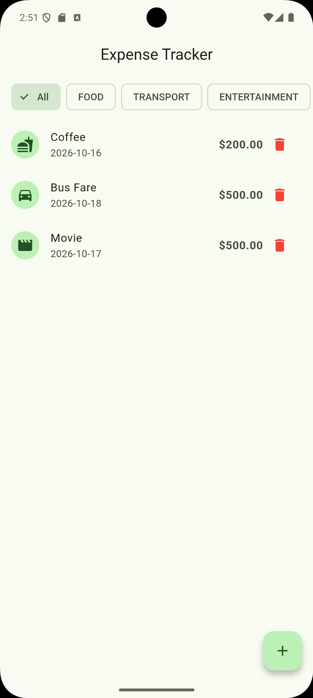
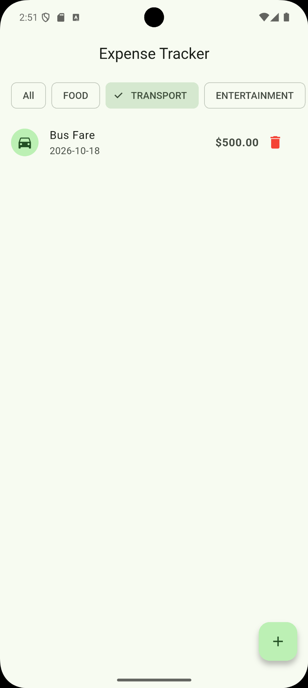
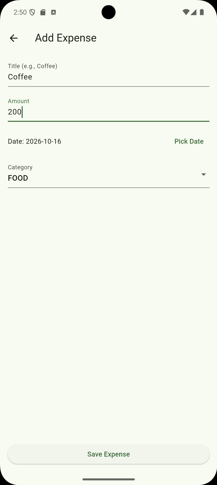
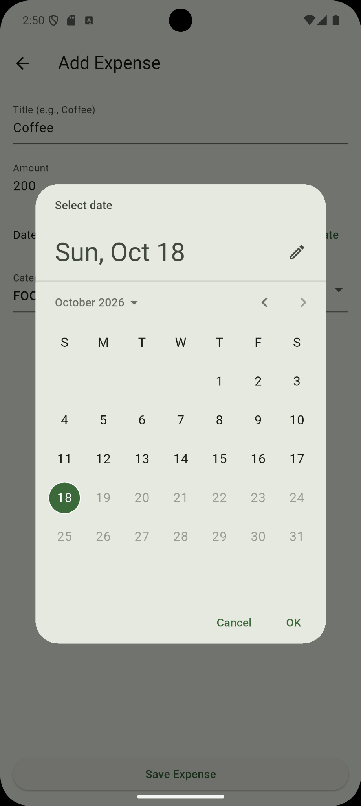
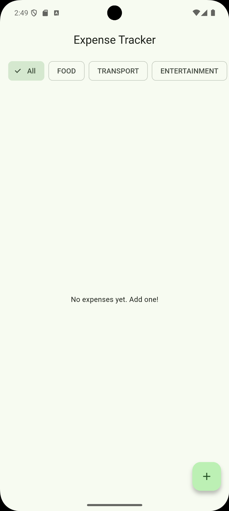

<div align="center">

# Expense Tracker

**A simple, offline-first expense tracking app built with Flutter.**

Record everyday spending, organize expenses into categories, and keep track of your transactions—all in a clean Material 3 interface.


</div>

---

## Overview

**Expense Tracker** is a Flutter application for managing personal expenses without an account or an internet connection. Add transactions with their amount, date, and category; view them in one place; filter by spending category; or remove entries you no longer need.

The project uses a **feature-first, layered structure** with separate presentation, domain, and data layers. **Riverpod** manages application state, while **SharedPreferences** stores expense records locally as serialized JSON.

## Screenshots

> Screenshots are from the Android app. Place the `screenshots/` folder beside this `README.md` for images to render on GitHub.

| All expenses | Category filter | Add expense |
|:---:|:---:|:---:|
|  |  |  |

| Date picker | Empty state |
|:---:|:---:|
|  |  |

## Features

- **Add expenses** — Enter a title and positive amount, choose a date, and assign a spending category.
- **Browse transactions** — See saved expenses with category icons, dates, and formatted amounts.
- **Filter by category** — Switch between **All**, **Food**, **Transport**, **Entertainment**, **Work**, and **Other**.
- **Delete expenses** — Remove individual transactions directly from the list.
- **Choose transaction dates** — Use the built-in date picker to select a date from January 1, 2000 through the current day.
- **Keep data locally** — Expense records persist on the device through SharedPreferences and can be accessed offline.
- **Reactive interface** — Riverpod refreshes the expense list after data changes and updates category filters.
- **Material 3 design** — A lightweight, green-accented interface with clear inputs, filter chips, and category icons.

## Built With

| Technology | Purpose |
|---|---|
| **Flutter & Dart** | Cross-platform UI and application logic |
| **flutter_riverpod / riverpod** | State management and dependency injection |
| **shared_preferences** | On-device storage for expense records |
| **Material 3** | UI components and visual styling |

## Architecture

The app organizes its expense feature into three layers:

- **Presentation:** Screens and Riverpod providers for rendering UI, handling user actions, and deriving filtered expenses.
- **Domain:** Expense entities, category definitions, and an abstract repository contract.
- **Data:** JSON serialization, the SharedPreferences data source, and the concrete repository implementation.

```text
lib/
├── main.dart
└── features/
    └── expenses/
        ├── data/
        │   ├── datasources/
        │   │   └── expense_local_data_source.dart
        │   ├── models/
        │   │   └── expense_model.dart
        │   └── repositories/
        │       └── expense_repository_impl.dart
        ├── domain/
        │   ├── entities/
        │   │   └── expense_entity.dart
        │   └── repositories/
        │       └── expense_repositories.dart
        └── presentation/
            ├── pages/
            │   ├── add_expense_page.dart
            │   └── expense_list_page.dart
            └── state/
                └── expense_provider.dart
```

**Data flow:** UI → Riverpod provider → repository interface / implementation → local data source → SharedPreferences.

At startup, `main.dart` initializes `SharedPreferences` and provides that instance to the Riverpod `ProviderScope`. Expense records are serialized to and from JSON, then persisted under a local storage key.

## Getting Started

### Prerequisites

- [Flutter SDK](https://docs.flutter.dev/get-started/install) installed and configured
- A Dart SDK compatible with **`^3.12.2`** (as specified in `pubspec.yaml`)
- Android Studio or VS Code (recommended), with an emulator or physical device

Verify your environment:

```bash
flutter doctor
```

### Installation

1. Clone your GitHub repository and navigate into the project:

   ```bash
   git clone YOUR_REPOSITORY_URL
   cd expense_tracker
   ```

2. Install dependencies:

   ```bash
   flutter pub get
   ```

3. Run the app:

   ```bash
   flutter run
   ```

> Replace `YOUR_REPOSITORY_URL` with the URL of your own repository. If the project is already on your computer, open its root directory and start with `flutter pub get`.

## How to Use

1. Open the app and tap the **+** button.
2. Enter an expense **title** and **amount**.
3. Optionally choose a different **date** and **category**.
4. Tap **Save Expense** to add the transaction.
5. Use the category chips to narrow the list, or tap a red trash icon to delete an expense.

## Current Scope

This version focuses on straightforward, **manual expense tracking**. Expenses are stored on the device, not synchronized with an online account. The displayed currency symbol is currently **`$`** and is not configurable in the app.

### Possible Future Improvements

These are ideas for future releases and **are not implemented in v1.0.0**:

- [ ] Expense editing
- [ ] Monthly summaries and spending charts
- [ ] Customizable currency and budget limits
- [ ] Search and sorting
- [ ] Export to CSV and optional cloud backup

---

<div align="center">

Built with **Flutter**, **Riverpod**, and **SharedPreferences**.

</div>
